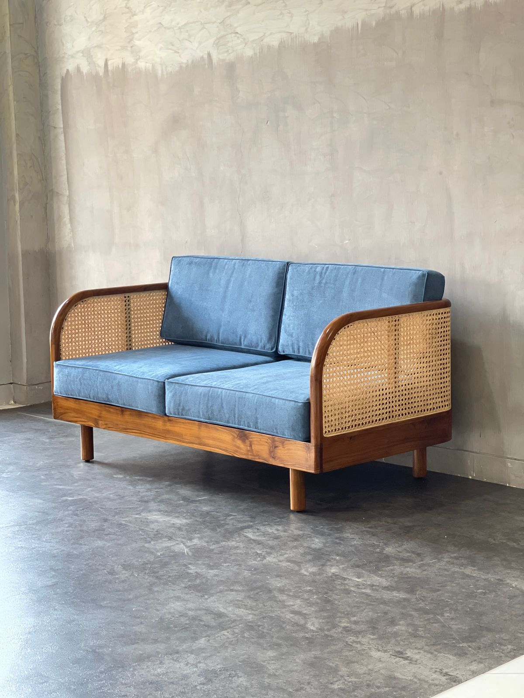

# Cara Menambahkan/Mengubah Foto Minimalist Furniture di Index

## 📁 Lokasi File Gambar
Folder: `assets/images/`
File yang dibutuhkan: `hero-furniture.jpg`

## 🖼️ Cara Menambahkan Gambar

### 1. Siapkan Gambar
- Format yang didukung: JPG, JPEG, PNG, WebP
- Ukuran yang direkomendasikan: 800x600px atau 1200x800px
- Nama file: `hero-furniture.jpg`

### 2. Upload Gambar
1. Buka folder: `C:\xampp\htdocs\massyukron\assets\images\`
2. Copy gambar Anda ke folder tersebut
3. Rename menjadi: `hero-furniture.jpg`

### 3. Alternatif: Mengubah Path Gambar
Jika ingin menggunakan nama file yang berbeda, edit file `index.php` baris 42:

```html
<!-- Sebelum -->


<!-- Sesudah (contoh) -->

```

## 🎨 Tips Gambar yang Baik

### Ukuran dan Format
- **Resolusi**: Minimal 800x600px
- **Format**: JPG untuk foto, PNG untuk gambar dengan transparansi
- **Ukuran file**: Maksimal 500KB untuk loading cepat

### Konten Gambar
- **Furniture minimalis** dengan desain clean
- **Kayu natural** atau finish kayu yang elegan
- **Background**: Putih atau netral untuk kontras yang baik
- **Komposisi**: Furniture sebagai fokus utama

### Optimasi
- Kompres gambar untuk mengurangi ukuran file
- Gunakan aspect ratio yang sesuai (16:9 atau 4:3)
- Pastikan gambar tidak blur atau pixelated

## 🔧 Cara Mengubah Gambar via Admin Panel

### 1. Login ke Admin Panel
- URL: `http://localhost/massyukron/admin/`
- Username: `admin`
- Password: `admin123`

### 2. Upload Gambar Baru
1. Buka menu "Products"
2. Klik "Add New Product"
3. Upload gambar furniture yang ingin ditampilkan
4. Simpan sebagai produk baru

### 3. Gunakan Gambar Produk sebagai Hero
Copy gambar dari folder `uploads/` ke `assets/images/` dan rename menjadi `hero-furniture.jpg`

## 📱 Responsive Design
Gambar akan otomatis responsive di berbagai ukuran layar:
- **Desktop**: Gambar penuh dengan aspect ratio yang terjaga
- **Tablet**: Gambar menyesuaikan lebar layar
- **Mobile**: Gambar stack di bawah teks hero

## 🎯 Contoh Gambar yang Cocok
- Kursi minimalis dengan kayu jati
- Meja makan dengan desain clean
- Lemari storage dengan finish natural
- Set furniture ruang tamu minimalis
- Furniture office dengan desain modern

## ⚠️ Troubleshooting

### Gambar Tidak Muncul
1. Periksa path file: `assets/images/hero-furniture.jpg`
2. Pastikan nama file sesuai (case sensitive)
3. Periksa permission folder images

### Gambar Terlalu Besar/Kecil
1. Edit CSS di `assets/css/style.css`
2. Cari class `.hero-image img`
3. Sesuaikan `width`, `height`, atau `object-fit`

### Loading Lambat
1. Kompres gambar (gunakan tools online)
2. Konversi ke format WebP untuk browser modern
3. Gunakan lazy loading untuk gambar tambahan
